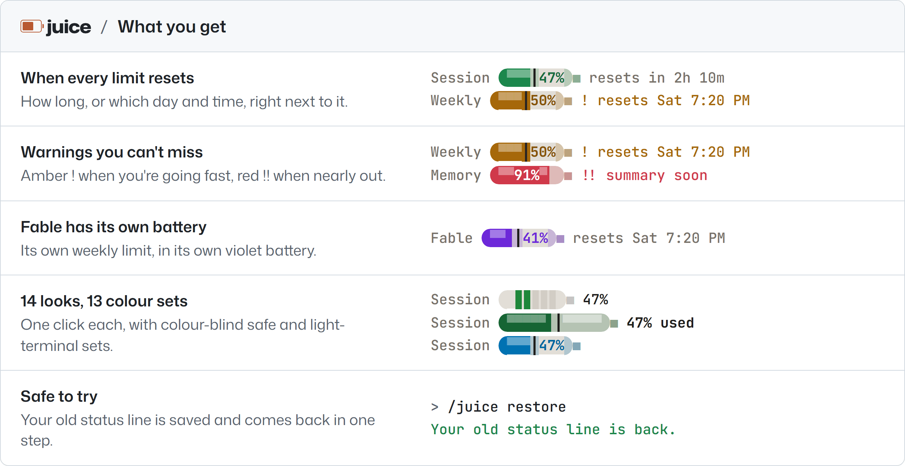

<div align="center">

# juice

[](https://github.com/zdraveski/claude-juice/actions/workflows/test.yml) [](https://github.com/zdraveski/claude-juice/releases/latest) [](LICENSE)

**Your Claude Code usage limits as batteries under your prompt, turning amber, then red, when you're using them too fast.**

juice shows your 5-hour session, your weekly limit, the Fable limit and how full this chat is. It counts the same way as Anthropic's usage page, says when each limit resets and, if you're on track to run out before then, at what time.

Free, open source and unofficial: juice is not made by Anthropic.

[Install](#install) · [Safe to try](#safe-to-try) · [What you get](#what-you-get) · [Make it yours](#make-it-yours) · [Guide](docs/guide.md) · [Fix or update](docs/troubleshooting.md) · [Privacy](docs/privacy.md)

</div>

<picture>
  <source media="(prefers-color-scheme: dark)" srcset="docs/images/hero-dark.png">
  
</picture>

## Know before you run out

juice keeps your limits in sight while you work. It colours Session, Weekly and Fable by your pace as well as by how much is used, so a limit that is draining too fast warns you while there is still time to slow down or wrap up.

- Green means plenty left.
- Amber with ! means you are going a bit fast. At this pace you will use most of it (85% or more) before it resets.
- Red with !! means almost empty, or half or more used and on track to run out before it resets.
- An amber or red battery that is on track to run out before it resets also says when, for example "runs out ~4:04 PM · resets in 2h 10m".
- Fable has its own colour while it is fine, violet in most colour sets.

<picture>
  <source media="(prefers-color-scheme: dark)" srcset="docs/images/colours-dark.png">
  
</picture>

## Safe to try

- Setup saves your old status line first, and `/juice restore` puts it back.
- Only the Fable battery needs your Claude login, and juice asks before it reads it, unless you already had the Fable battery before 1.4.0 on Windows or Linux. If you say no, Session, Weekly and Memory still work, though a window you're not using can show older numbers.
- The only thing juice itself sends anywhere is a usage request to `api.anthropic.com`, and only while the Fable battery is on.

[Privacy](docs/privacy.md) has the details, with links to the code that reads your login and sends it.

## Install

You need Node 24 or newer. To check, type `node --version` in a terminal; if you don't have it, get it from [nodejs.org](https://nodejs.org). Then type these into Claude Code, one at a time:

1. Add the juice marketplace:

   ```
   /plugin marketplace add zdraveski/claude-juice
   ```

2. Install juice:

   ```
   /plugin install juice@juice
   ```

3. Load it:

   ```
   /reload-plugins
   ```

4. Set it up:

   ```
   /juice setup
   ```

If Claude Code still doesn't know `/juice`, restart it and type `/juice setup` again. Setup asks you one question, about the Fable battery (see [Safe to try](#safe-to-try)).

The very first time, the batteries fill in after Claude's first reply; until then only the model and effort level show. After that, a new chat shows Session and Weekly straight away, and Memory after the first reply.

To update later, open `/plugin`, pick juice, and update it, then restart Claude Code. [What's new](CHANGELOG.md) lists what each version changed.

juice works on Windows, macOS and Linux (tested by hand on Windows, automatically on all three). On a Mac or Linux, please [tell us](https://github.com/zdraveski/claude-juice/issues/new?template=bug_report.yml) if something looks off.

### Where juice shows

juice is made for Claude Code only. It shows wherever Claude Code shows a status line, which is when you run `claude` in a terminal:

| Where you use Claude Code | juice |
| --- | --- |
| A terminal window: PowerShell, Git Bash, Windows Terminal, macOS Terminal, iTerm, Linux | Shows (tested on Windows) |
| The terminal inside VS Code, run `claude` there | Shows, with round battery ends (tested) |
| The terminal inside JetBrains, Cursor or another editor | Should show, as in any terminal (not tested) |
| The Claude chat panel in VS Code | Doesn't show: Claude Code doesn't run a status line there (tested) |
| The Code tab in the Claude desktop app | Didn't show in our last test (Windows) |
| claude.ai/code | Not tested |

If you use the VS Code chat panel or the desktop app, open a terminal and type `claude` to see juice.

## What you get

<picture>
  <source media="(prefers-color-scheme: dark)" srcset="docs/images/features-dark.png">
  
</picture>

[The guide](docs/guide.md#what-the-batteries-mean) explains every battery, the thin line that marks an even pace, and the reset times.

## Make it yours

Pick one of 14 ready-made looks, then change anything you like: the layout, the colours, what shows and the battery style.

<picture>
  <source media="(prefers-color-scheme: dark)" srcset="docs/images/looks-dark.png">
  
</picture>

Type `/juice` and then say what you want, in your own words. For example:

- `/juice looks` (shows all 14 looks, numbered; then `/juice look 7` switches to number 7)
- `/juice use the quiet look`
- `/juice my terminal is light` (if the text is hard to read on a light background)

<p align="center">
  <a href="https://zdraveski.github.io/claude-juice/web/"><picture><source media="(prefers-color-scheme: dark)" srcset="docs/images/open-customizer-dark.png"></picture></a>
  <br>
  <sub>Try every look, layout and colour with a live preview, without installing anything.</sub>
</p>

[The guide](docs/guide.md#ready-made-looks) shows every look, layout, colour set and battery style.

## More

- [Guide](docs/guide.md): every battery, look, layout, colour set and battery style.
- [Fix, update or remove juice](docs/troubleshooting.md): `/juice doctor`, common problems, updating, undoing and uninstalling.
- [Privacy](docs/privacy.md): what juice reads and sends, and where.
- [Badges](docs/badges.md): small optional extras that show the output of a command you choose.
- [What's new](CHANGELOG.md): what each version changed.

## Help and feedback

- Something wrong? [Open a bug report](https://github.com/zdraveski/claude-juice/issues/new?template=bug_report.yml) with what `/juice doctor` says.
- A question? [Ask in Discussions](https://github.com/zdraveski/claude-juice/discussions).
- A security problem? Please report it privately, as [SECURITY.md](SECURITY.md) explains, not in a public issue.
- Want to change the code? See [CONTRIBUTING.md](CONTRIBUTING.md).

juice is free and open source under the [MIT license](LICENSE). It is not made by Anthropic.
