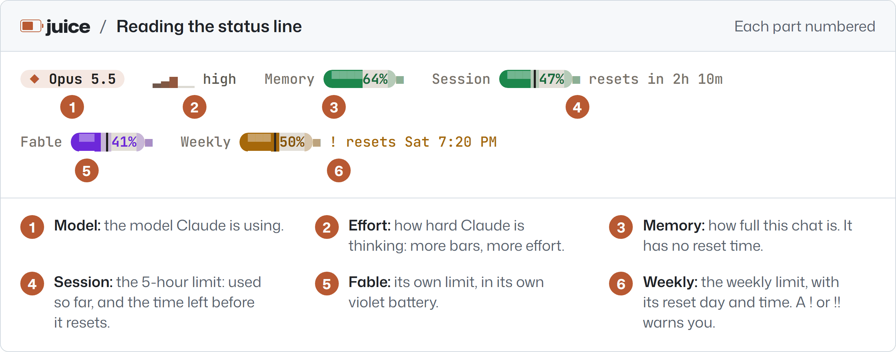
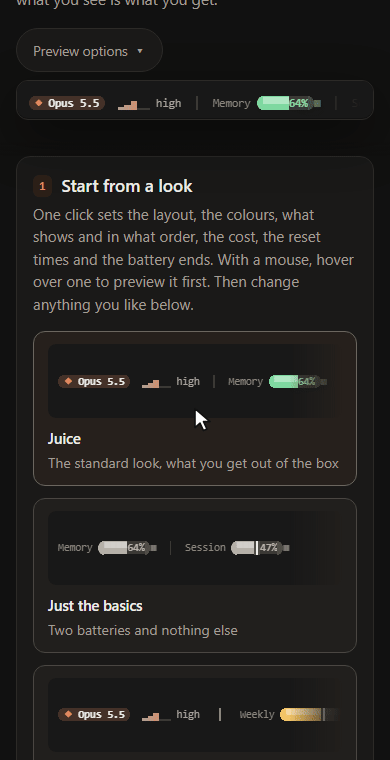

<div align="center">

# juice

[](https://github.com/zdraveski/claude-juice/actions/workflows/test.yml) [](https://github.com/zdraveski/claude-juice/releases/latest) [](LICENSE)

**juice** shows your Claude Code usage limits as little batteries under your prompt: your 5-hour session, your weekly limit, the Fable limit and how full this chat is. It counts the same way as Anthropic's usage page, says when each limit resets, and warns you before you run out.

Free, open source and unofficial: juice is not made by Anthropic.

[Install](#install) · [What you get](#what-you-get) · [The batteries](#what-the-batteries-mean) · [Looks](#ready-made-looks) · [Change how it looks](#change-how-it-looks) · [Badges](#badges) · [Something wrong?](#if-something-looks-wrong) · [Update and uninstall](#update-undo-and-uninstall) · [Privacy](#privacy) · [Help](#help-and-feedback)

</div>

<picture>
  <source media="(prefers-color-scheme: dark)" srcset="docs/images/hero-dark.png">
  
</picture>

## Install

You need Node 24 or newer. To check, type `node --version` in a terminal; if you don't have it, get it from [nodejs.org](https://nodejs.org). Then type these into Claude Code, one at a time:

1. Add the juice marketplace:

   ```
   /plugin marketplace add zdraveski/claude-juice
   ```

2. Install juice:

   ```
   /plugin install juice@juice
   ```

3. Load it:

   ```
   /reload-plugins
   ```

4. Set it up:

   ```
   /juice setup
   ```

If Claude Code still doesn't know `/juice`, restart it and type `/juice setup` again. juice saves your old status line first, if you had one, so `/juice restore` can always bring it back.

Setup asks you once whether juice may read your Claude login for the Fable battery. Saying no keeps everything else working. [More in Privacy](#privacy).

The very first time, the batteries fill in after Claude's first reply; until then only the model and effort level show. After that, a new chat shows Session and Weekly straight away, and Memory after the first reply.

The only thing juice itself sends anywhere is a usage request to `api.anthropic.com`, and only while the Fable battery is on. It fills the Fable battery and keeps Session and Weekly up to date.

juice works on Windows, macOS and Linux (tested by hand on Windows, automatically on all three). On a Mac or Linux, please [tell us](https://github.com/zdraveski/claude-juice/issues/new?template=bug_report.yml) if something looks off.

### Where juice shows

juice is made for Claude Code only. It shows wherever Claude Code shows a status line, which is when you run `claude` in a terminal:

| Where you use Claude Code | juice |
| --- | --- |
| A terminal window: PowerShell, Git Bash, Windows Terminal, macOS Terminal, iTerm, Linux | Shows (tested on Windows) |
| The terminal inside VS Code, run `claude` there | Shows, with round battery ends (tested) |
| The terminal inside JetBrains, Cursor or another editor | Should show, as in any terminal (not tested) |
| The Claude chat panel in VS Code | Doesn't show: Claude Code doesn't run a status line there (tested) |
| The Code tab in the Claude desktop app | Didn't show in our last test (Windows) |
| claude.ai/code | Not tested |

If you use the VS Code chat panel or the desktop app, open a terminal and type `claude` to see juice.

<p align="center">
  <a href="https://zdraveski.github.io/claude-juice/web/"><picture><source media="(prefers-color-scheme: dark)" srcset="docs/images/open-customizer-dark.png"></picture></a>
  <br>
  <sub>Try every look, layout and colour with a live preview, without installing anything.</sub>
</p>

## What you get

<picture>
  <source media="(prefers-color-scheme: dark)" srcset="docs/images/features-dark.png">
  
</picture>

## What the batteries mean

<picture>
  <source media="(prefers-color-scheme: dark)" srcset="docs/images/anatomy-dark.png">
  
</picture>

| Battery | What it shows |
|:---|:---|
| Memory | How full this chat is. When it fills up, Claude summarises the chat to make room. |
| Session | Your 5-hour limit. |
| Fable | The separate weekly limit for the Fable model, called "Fable weekly" in the Panel layout and as the big battery in Tightest first. It resets with Weekly, so it shows no reset time of its own while Weekly is shown. |
| Weekly | Your weekly limit. |
| Budget | Only with a company spending limit: how much of it is used. Amber with ! at 85%, red with !! at 90%. |

Next to the batteries you also see the model's name and its effort level: a little staircase from 1 step (low) to 5 steps (max), with the word beside it. By default the staircase and the batteries stand still at their true level, and juice refreshes once a minute, so the numbers and reset times stay current while Claude Code is idle at almost no cost.

To make them move, type `/juice set motion=on`. The staircase then climbs up to your level, one step every 2 seconds, holds there, then starts again; the word always says the level (when a narrow window hides the word, the staircase stands still). The batteries' pictures climb the same way, in four steps from a quarter of the way up to the real amount, and everything starts again together every 12 seconds; the number and words beside them never move, and a red battery stands still. With motion on, juice refreshes every second (twice a step, so no step is skipped). That costs about a sixth of one processor core for each open Claude Code window.

If you set your own refresh time in Claude Code's settings (`refreshInterval`, in seconds), such as 10 or 20, juice keeps it either way. It changes only 1, 30 and 60, the times juice writes itself.

The rounded battery ends in the pictures show on their own in VS Code. Other terminals get plain ends, because some fonts draw the rounded ones as boxes; if yours can draw them, type `/juice use round ends`.

Session and Weekly also say when they reset: "resets in 1h 31m" when it is less than a day away, otherwise the day and time ("resets Sat 7:20 PM"). Times are in your computer's time zone; on a computer set to UTC, such as a remote computer you work on from yours, they say "UTC".

The colours for Session, Weekly and Fable depend on your pace as well as on how much is used:

- Green means plenty left.
- Amber with ! means you are going a bit fast. At this pace you will use most of it (85% or more) before it resets.
- Red with !! means almost empty, or half or more used and on track to run out before it resets.
- An amber or red battery that is on track to run out before it resets also says when, for example "runs out ~4:04 PM · resets in 2h 10m".

While Fable is fine it has its own colour (violet in most colour sets), so you can tell it apart. When it goes fast or runs low it turns amber or red with ! or !! like the others.

<picture>
  <source media="(prefers-color-scheme: dark)" srcset="docs/images/colours-dark.png">
  
</picture>

In the Status bar, Tightest first and Panel layouts, a thin line on these batteries marks where you would be if you used the limit evenly. If the colour reaches past the line, you are going faster than that. Before the line, you have time to spare. The Pace style shows the same thing as a softer fill up to that point. Of the shapes, only Pace race and Ruler draw the line.

A limit that is used up always shows, even in a look that leaves it out (Fable while you are using Fable), so you never see "all fine" while you are locked out.

Memory has no pace or reset. It turns amber, then red, as the chat fills up.

Pro and Max plans show the limits that apply to them. If you pay as you go with an API key (billed for what you use, instead of a plan), you see your cost instead.

## Ready-made looks

A look sets the layout, the colours, what shows and in what order, the cost, the reset times and the battery ends, all in one go. Your battery style, terminal colour, motion, Fable setting and badges stay as they are. Pick one, then change anything you like. (If you chose round or plain ends yourself, type `/juice use round ends` or `/juice use plain ends` again after picking a look.)

<picture>
  <source media="(prefers-color-scheme: dark)" srcset="docs/images/looks-dark.png">
  
</picture>

<details>
<summary>The 14 looks in words</summary>

| Look | What it is |
|:---|:---|
| Juice | The standard look. Pick it to go back to the start. |
| Just the basics | Two batteries and nothing else. |
| Spotlight | The battery that needs you most is big, the rest stay small. |
| Everything | One row per battery, every detail spelled out. |
| Retro phone | Signal bars like an old phone, in cool colours. |
| Quiet | Grey until something needs you. Reset times only show then. |
| Night owl | Neon bars for dark terminals. |
| Easy to see | Like Spotlight, in bright high-contrast colours. |
| Colour-blind friendly | Blue, amber and red that every kind of colour blindness tells apart. |
| Works everywhere | For older terminals that show boxes instead of rounded ends. |
| Cost watcher | Shows what this chat would have cost. |
| Fable first | The Fable battery leads, and lights up while you use Fable. |
| Capsule | Rounded capsules in Candy colours that fill with colour when they need you. |
| Road trip | A fuel gauge in Forest colours: shows what is left, not what is used. |

Capsule and Road trip use the Capsules and Fuel tank layouts (see [Six layouts](#six-layouts)).

</details>

### Six layouts

| Layout | What it does | See it in the look |
|:---|:---|:---|
| Status bar (the default) | Everything on one line. | Juice |
| Classic segments | Each battery is five bars, like the signal on an old phone. | Retro phone |
| Tightest first | The battery closest to running out gets big; the rest shrink to numbers. | Spotlight |
| Panel | Each battery gets its own row, with the most detail. | Everything |
| Capsules | Each battery is a rounded capsule. A fine one stays dark; one that needs you fills with its colour, and only that one says its times. | Capsule |
| Fuel tank | Shows what is left instead of what is used, like a fuel gauge: the bar empties as you work. | Road trip |

The batteries keep the order you chose. To let them move instead, type `/juice put the one that needs me first` (red, then amber, then fine) or `/juice put the fullest first`. `/juice keep my order` puts them back.

### Colour sets

There are 13 colour sets to choose from: Claude, Frost, Calm, Colour-blind safe, High contrast, Ocean, Midnight, Vampire, Candy, Forest, Sunset, Solar and Rose. Every colour in them reads at 4.5:1 or more on its terminal. Or make your own in the customizer, which tells you when one is hard to read.

<picture>
  <source media="(prefers-color-scheme: dark)" srcset="docs/images/colour-sets-dark.png">
  
</picture>

## Change how it looks

[Open the live customizer](https://zdraveski.github.io/claude-juice/web/) to try every look, layout and colour with a live preview, then copy one line into Claude Code. It runs in your browser, so there is nothing to install.

[](https://zdraveski.github.io/claude-juice/web/)

Or type `/juice` and then say what you want, in your own words. For example:

- `/juice looks` (shows all 14 looks, numbered; then `/juice look 7` switches to number 7)
- `/juice use the quiet look`
- `/juice hide the cost`
- `/juice use the calm colours`
- `/juice show the reset times only when something needs attention`
- `/juice make it a panel`
- `/juice my terminal is light` (if the text is hard to read on a light background)
- `/juice set motion=on` (the effort level and batteries climb; juice then refreshes every second, about a sixth of a CPU core per open window)
- `/juice customize` (opens the live customizer with your current settings)

### Battery style

The batteries in the Status bar and Tightest first layouts can be drawn six ways, or swapped for one of eight shapes. The other layouts keep their own shapes.

- **Glossy** (the default): each battery lit from above, in glass tinted by its colour.
- **Classic**: the flat bars juice started with. Type `/juice set battery=classic` to go back to them.
- **Outline**: thin walls and dots, no filled casing.
- **Hot tip**: when a battery turns amber or red, its fill heats from the plenty-left colour (green in most sets) to that colour.
- **Liquid edge**: a bright edge where the fill ends.
- **Pace glow**: the fill is soft up to where even use would be now, and bright past it, so going fast shows at a glance.

The shapes put the number after them, and read without colour too:

- **Pie** `◑ 47%`: one little pie that fills by quarters.
- **Sand** `⣿⣿⣄⠂⠂ 47%`: fine grains that pile up, eight to a cell.
- **Slider** `━━━●──── 47%`: a knob on a track.
- **Pace race** `···│●···· 47%`: you (●) racing even use (│). Here you're ahead of the line, so going fast. On the line, you cover it.
- **Lives** `♥♥♥♡♡ 47%`: what is left, as hearts.
- **Dots** `••••···· 47%`: a string of beads.
- **Chevrons** `▸▸▸▹▹▹ 47%`: arrows that march on as you use it.
- **Ruler** `┣━━╋━────┫ 47%`: a ruler with even use as a tick. Here the tick is inside the fill, so you're ahead. On pace it sits on the fill's end; behind, it stands past it as `┿`.

The Pace race and Ruler examples are 47% used with 40% of the window gone. Of the shapes, only those two show where even use would be. Pie, Sand, Chevrons, Lives and Ruler need a font that has those signs (Cascadia Code, JetBrains Mono and Menlo do). If you see boxes, pick another.

Pick one in the customizer, or type `/juice set battery=outline` (or any of glossy, classic, outline, hot, liquid, pace, pie, sand, slider, race, lives, dots, chevrons, ruler).

In a narrow window juice drops the extras first and keeps the batteries that need you until last.

<details>
<summary>What a narrow window drops, in order</summary>

In a narrow window juice makes room step by step. First go badges, reset times, the effort word and cost, then the effort level and the model name. Next come spacing, battery size, an amber battery's run-out time, the reset time beside a run-out time, and shorter warning words. Then every battery shows as words only (`Session 88%!! out ~2:44 PM`). After that go the batteries that are fine, then the amber ones, and last a red battery's words ("out ~2:44 PM"), so a red battery itself is the last thing to go. Whatever freed room gets used again, so a battery keeps its picture whenever it fits. Only in a very small window is the end of the line cut.

</details>

## Badges

Badges are small optional extras that show the output of a command you choose. They update about every 30 seconds while you work.

- Add one with `/juice badges add`. juice shows you the command before it adds it.
- See yours, numbered, with `/juice badges list`. It shows the first word of each command; `/juice badges list --show` shows the whole command and asks first.
- Don't put passwords or API keys in a badge command. juice runs it as typed, and the chat can see it.
- Remove the first one with `/juice badges remove 1` (it asks first).
- Only the first line of the output shows, up to 40 characters.
- A command that takes longer than 2 seconds is stopped and keeps its last text.
- The command gets the same details Claude Code gives the status line (the folder, chat and cost).
- A badge runs in the folder Claude Code is working in. A `git` badge there also follows that folder's own git settings, which can start other programs, so take care in a folder someone handed you (a cloned project doesn't bring its settings along).
- Badges are the first thing a narrow window hides.
- On Windows, badge commands run in the Windows command prompt (cmd), not Git Bash, so write them for cmd. cmd's own commands, like `echo`, turn letters such as é into plain ones; programs like `git` show them as they are.

juice only runs badges you added yourself on this computer: each one is approved with a secret that stays on this computer, so a `juice.json` copied from somewhere else never runs anything. `/juice badges list` marks each badge that isn't approved here, including badges added before juice 0.2.5. To approve one, add the same command again with `/juice badges add` (`/juice badges list --show` shows it). It keeps its place in the list. If the list calls a badge a copy of another one, remove that copy instead.

## If something looks wrong

Type `/juice doctor` first (when juice itself hits a problem, the line says `juice: /juice doctor` until the next run that works). It checks, in plain words, your Node version, whether juice is your status line, which juice it runs, whether a project setting hides it, whether your juice settings and badges are usable, whether drawing works with them, when juice last saw your limits, how the Fable battery is doing and the last problem the status line hit, and says what to do about each. It never shows your badge commands or another status line's command, and your home folder reads `~`, so it doesn't show your user name. If you ask for help, [open a bug report](https://github.com/zdraveski/claude-juice/issues/new?template=bug_report.yml) and include what it says.

- **The status line is empty.** Type `/juice setup` again; it repairs the line and says if a project setting or `disableAllHooks` is hiding it. If it is still empty, check that Node is installed (type `node --version` in a terminal; you need 24 or newer, from nodejs.org), then restart Claude Code.
- **The text is hard to read on a light background.** Type `/juice my terminal is light`.
- **You see boxes or question marks instead of round battery ends.** Type `/juice use plain ends`.
- **You want round battery ends outside VS Code.** Type `/juice use round ends`.
- **The line runs past the edge or wraps.** Some terminals set up for Chinese, Japanese or Korean draw symbols like `■`, `░` and `·` two columns wide. Look for a setting called "ambiguous width" (iTerm2 and GNOME Terminal have one) and set it to narrow.
- **There is no Fable battery.** juice asks before it reads your login, so type `/juice set fable=on` if you said no. Then `/juice doctor` says how the last check went and what to do, for example to type `/login` when Anthropic refused your sign-in.
- **The Fable battery doesn't show at work, behind a company proxy.** juice goes through the proxy named in `HTTPS_PROXY` (or `https_proxy`), so set it where you start Claude Code. If your company inspects secure connections, also point `NODE_EXTRA_CA_CERTS` at its certificate file.
- **It says "juice is turned off" or "juice is not installed".** Turn juice back on, or install it again, in `/plugin`. Then `/juice setup` uses it, or `/juice restore` gives you your old status line back. If you don't want juice back, delete the `statusLine` entry in `~/.claude/settings.json`; your old one is in `~/.claude/juice-backup.json`.

## Update, undo and uninstall

- To update, open `/plugin`, pick juice, and update it, then restart Claude Code. Your settings and badges stay. [What's new](CHANGELOG.md) lists what each version changed.
- To undo, type `/juice restore`. It puts your old status line back.
- To uninstall, run `/juice restore` first, then remove juice in `/plugin`. If you uninstall first, the status line tells you how to get back.

<details>
<summary>Remove every juice file</summary>

After uninstalling, juice's own files are still in your Claude folder (`~/.claude`, or your `CLAUDE_CONFIG_DIR` folder): `juice.json` (your settings and badge commands), the `juice-cache` folder (usage numbers, a list of recent chats, and, if you use badges, their approval and what Claude Code told the status line about each chat, including its project folder), any older `juice-backup-….json` copies, and, if you uninstalled before `/juice restore`, `juice-statusline.mjs`, `juice-backup.json` (your old status line) and the `statusLine` entry in `settings.json` (Claude can remove it for you). Delete them if you want nothing left. (Deleting `juice-cache` while juice is installed is harmless, except that your badges stop running until you approve each one again by adding the same command with `/juice badges add`.)

</details>

## Privacy

- The Fable battery needs your Claude login token, the key Claude Code keeps on your computer to sign you in. juice reads it from `.credentials.json` in your Claude folder (`~/.claude`, or your `CLAUDE_CONFIG_DIR` folder), or on a Mac from the Keychain (the Mac's password store).
- juice asks before it reads the token, on every system. `/juice setup` asks once, and `/juice set fable=on` or `/juice set fable=off` changes your answer later. If you used juice before 1.4.0 on Windows or Linux and already have a Fable battery, it stays on.
- On a Mac, macOS also asks once for permission to read the token from the Keychain. This is new on the Mac. If macOS asks more than once, or the battery doesn't appear within a few minutes, please [tell us](https://github.com/zdraveski/claude-juice/issues/new?template=bug_report.yml) what `/juice doctor` says.
- Share links and the customizer's command never turn the Fable battery on or off; only you do.
- juice sends that token only to `api.anthropic.com`, to read your usage, about every 5 minutes. It never stores or logs it. juice keeps only your usage numbers, in `juice-cache/fable.json`.
- If your login has expired, juice sends nothing and looks again in 5 minutes. If a check fails, it waits 15 minutes before the next one.
- If `HTTPS_PROXY` (or `https_proxy`) is set, the proxy it names carries juice's connection to Anthropic, as it does for Claude Code.
- Anthropic doesn't publish the usage address juice reads (`api.anthropic.com/api/oauth/usage`) for others to use, so it may stop working.
- The same usage reading also keeps Session and Weekly up to date in every window, including idle ones and brand-new chats. With the Fable battery off, those two come only from Claude Code itself, so an idle window can show older numbers.
- To switch the Fable battery off, run `/juice set fable=off`.
- Badges only run commands you added yourself with `/juice badges add`, after juice shows you the command.
- Check it yourself: the token is read and sent in [src/fable.js](src/fable.js); badges run in [src/badges.js](src/badges.js).

## Help and feedback

- Something wrong? [Open a bug report](https://github.com/zdraveski/claude-juice/issues/new?template=bug_report.yml) with what `/juice doctor` says.
- A question? [Ask in Discussions](https://github.com/zdraveski/claude-juice/discussions).
- A security problem? Please report it privately, as [SECURITY.md](SECURITY.md) explains, not in a public issue.
- Want to change the code? See [CONTRIBUTING.md](CONTRIBUTING.md).

juice is free and open source under the [MIT license](LICENSE). It is not made by Anthropic.
