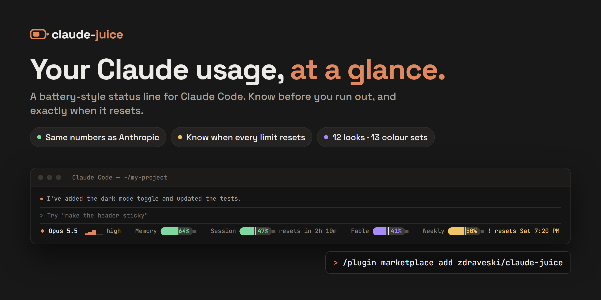
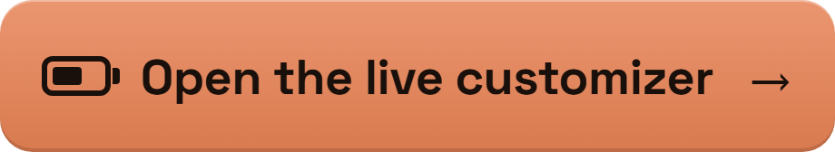
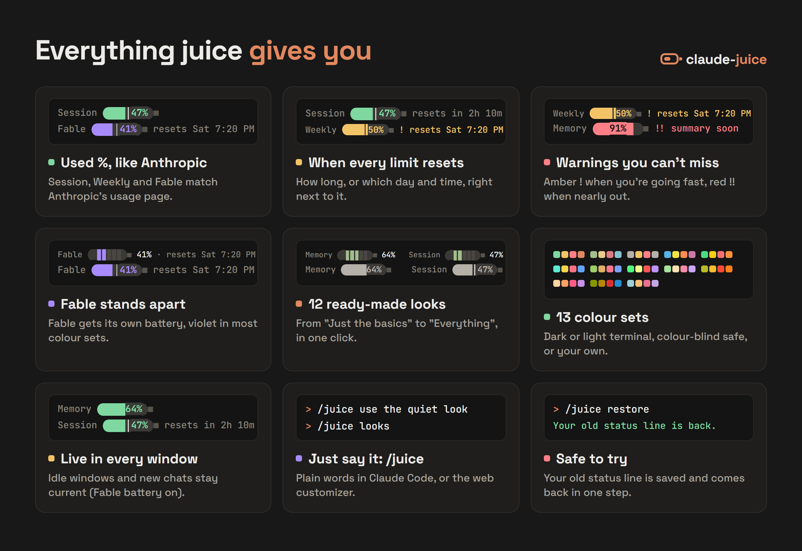
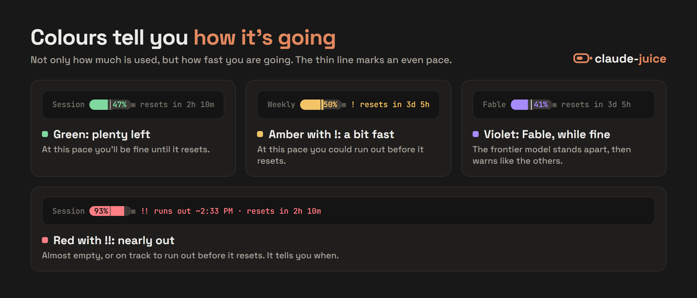
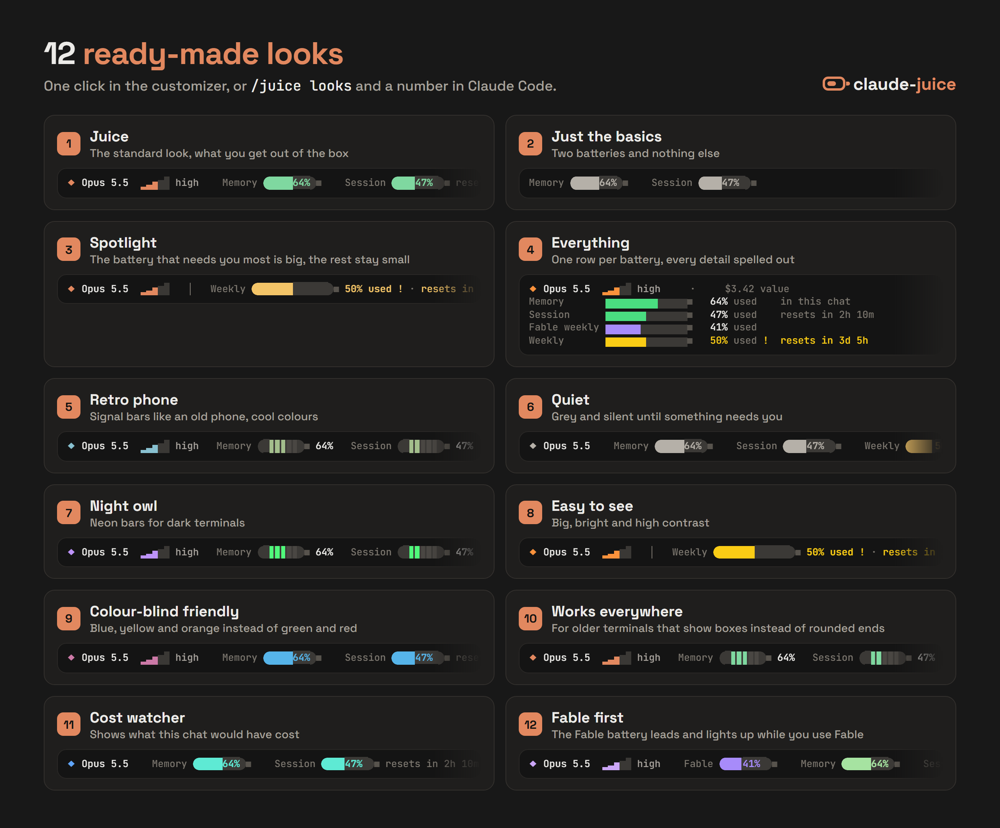
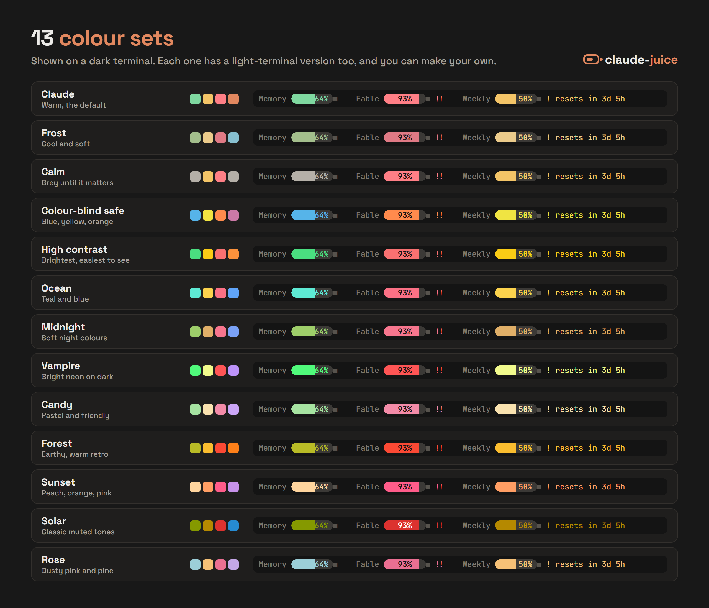
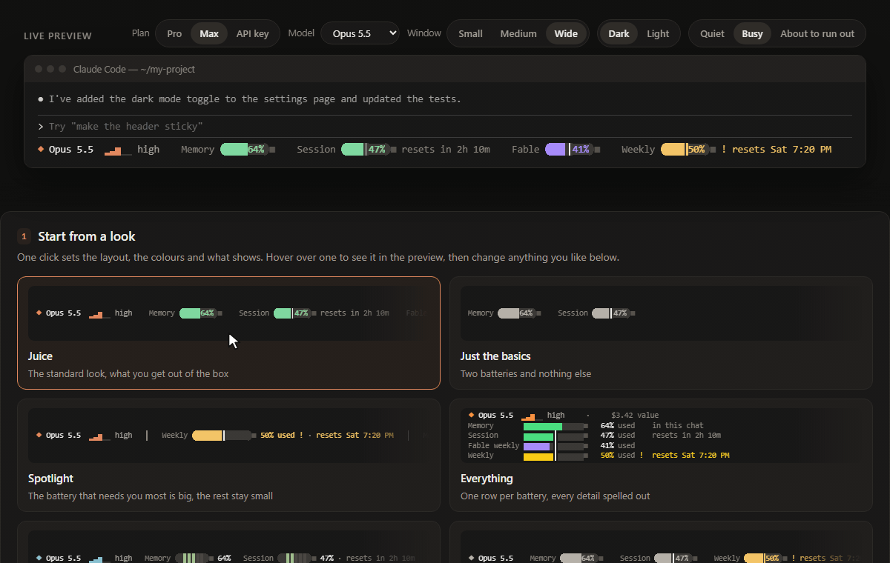

<div align="center">

# juice

[](https://github.com/zdraveski/claude-juice/actions/workflows/test.yml) [](https://github.com/zdraveski/claude-juice/releases/latest) [](LICENSE)

**juice** shows your Claude Code usage limits as little batteries under your prompt: your 5-hour session, your weekly limit, the Fable limit and how full this chat is. It counts the same way as Anthropic's usage page, says when each limit resets, and warns you before you run out.

Free, open source and unofficial: juice is not made by Anthropic.

[Install](#install) · [What you get](#what-you-get) · [The batteries](#what-the-batteries-mean) · [Looks](#ready-made-looks) · [Change how it looks](#change-how-it-looks) · [Badges](#badges) · [Something wrong?](#if-something-looks-wrong) · [Update and uninstall](#update-undo-and-uninstall) · [Privacy](#privacy) · [Help](#help-and-feedback)

</div>



## Install

You need Node 18 or newer. To check, type `node --version` in a terminal; if you don't have it, get it from [nodejs.org](https://nodejs.org). Then type these into Claude Code, one at a time:

1. Add the juice marketplace:

   ```
   /plugin marketplace add zdraveski/claude-juice
   ```

2. Install juice:

   ```
   /plugin install juice@juice
   ```

3. Load it:

   ```
   /reload-plugins
   ```

4. Set it up:

   ```
   /juice setup
   ```

If Claude Code still doesn't know `/juice`, restart it and type `/juice setup` again. juice saves your old status line first, if you had one, so `/juice restore` can always bring it back.

The very first time, the batteries fill in after Claude's first reply; until then only the model and effort level show. After that, a new chat shows Session and Weekly straight away, and Memory after the first reply.

The only thing juice itself sends anywhere is a usage request to `api.anthropic.com`, while the Fable battery is on (on a Mac it starts off). It fills the Fable battery and keeps Session and Weekly up to date. [More in Privacy](#privacy).

juice works on Windows, macOS and Linux (tested by hand on Windows, automatically on all three). On a Mac or Linux, please [tell us](https://github.com/zdraveski/claude-juice/issues/new?template=bug_report.yml) if something looks off.

<p align="center">
  <a href="https://zdraveski.github.io/claude-juice/web/"></a>
  <br>
  <sub>Try every look, layout and colour with a live preview, without installing anything.</sub>
</p>

## What you get



## What the batteries mean


| Battery | What it shows |
|:---|:---|
| Memory | How full this chat is. When it fills up, Claude summarises the chat to make room. |
| Session | Your 5-hour limit. |
| Fable | The separate weekly limit for the Fable model, called "Fable weekly" in the Panel layout and as the big battery in Tightest first. It resets with Weekly, so it shows no reset time of its own while Weekly is shown. |
| Weekly | Your weekly limit. |
| Budget | Only with a company spending limit: how much of it is used. Amber with ! at 85%, red with !! at 90%. |

Next to the batteries you also see the model's name and its effort level: a little staircase that climbs from 1 step (low) to 5 steps (max), with the word beside it.

The rounded battery ends in the pictures show on their own in VS Code. Other terminals get plain ends, because some fonts draw the rounded ones as boxes; if yours can draw them, type `/juice use round ends`.

Session and Weekly also say when they reset: "resets in 1h 31m" when it is less than a day away, otherwise the day and time ("resets Sat 7:20 PM"). Times are in your computer's time zone; on a computer set to UTC, such as a server you reach over SSH, they say "UTC".

The colours for Session, Weekly and Fable depend on your pace as well as on how much is used:

- Green means plenty left.
- Amber with ! means you are going a bit fast. At this pace you will use most of it (85% or more) before it resets.
- Red with !! means almost empty, or half or more used and on track to run out before it resets. A red battery that is on track to run out also says when, for example "runs out ~4:04 PM · resets in 2h 10m".

While Fable is fine it has its own colour (violet in most colour sets), so you can tell it apart. When it goes fast or runs low it turns amber or red with ! or !! like the others.



In every layout except Classic segments, a thin line on these batteries marks where you would be if you used the limit evenly. If the colour reaches past the line, you are going faster than that. Before the line, you have time to spare.

A limit that is used up always shows, even in a look that leaves it out (Fable while you are using Fable), so you never see "all fine" while you are locked out.

Memory has no pace or reset. It turns amber, then red, as the chat fills up.

Pro and Max plans show the limits that apply to them. If you pay as you go with an API key, you see your cost instead.

## Ready-made looks

A look sets the layout, the colours, what shows, the cost, the reset times and the battery ends, all in one go. Your terminal colour, Fable setting and badges stay as they are. Pick one, then change anything you like. (If you chose round or plain ends yourself, type `/juice use round ends` or `/juice use plain ends` again after picking a look.)



<details>
<summary>The 12 looks in words</summary>

| Look | What it is |
|:---|:---|
| Juice | The standard look. Pick it to go back to the start. |
| Just the basics | Two batteries and nothing else. |
| Spotlight | The battery that needs you most is big, the rest stay small. |
| Everything | One row per battery, every detail spelled out. |
| Retro phone | Signal bars like an old phone, in cool colours. |
| Quiet | Grey until something needs you. Reset times only show then. |
| Night owl | Neon bars for dark terminals. |
| Easy to see | Like Spotlight, in bright high-contrast colours. |
| Colour-blind friendly | Blue, yellow and orange instead of green and red. |
| Works everywhere | For older terminals that show boxes instead of rounded ends. |
| Cost watcher | Shows what this chat would have cost. |
| Fable first | The Fable battery leads, and lights up while you use Fable. |

</details>

### Four layouts

| Layout | What it does | See it in the look |
|:---|:---|:---|
| Status bar (the default) | Everything on one line. | Juice |
| Classic segments | Each battery is five bars, like the signal on an old phone. | Retro phone |
| Tightest first | The battery closest to running out gets big; the rest shrink to numbers. | Spotlight |
| Panel | Each battery gets its own row, with the most detail. | Everything |

### Colour sets

There are 13 colour sets to choose from: Claude, Frost, Calm, Colour-blind safe, High contrast, Ocean, Midnight, Vampire, Candy, Forest, Sunset, Solar and Rose. Or make your own in the customizer.



## Change how it looks

[Open the live customizer](https://zdraveski.github.io/claude-juice/web/) to try every look, layout and colour with a live preview, then copy one line into Claude Code. It runs in your browser, so there is nothing to install.

[](https://zdraveski.github.io/claude-juice/web/)

Or type `/juice` and then say what you want, in your own words. For example:

- `/juice looks` (shows all 12 looks, numbered; then `/juice look 7` switches to number 7)
- `/juice use the quiet look`
- `/juice hide the cost`
- `/juice use the calm colours`
- `/juice show the reset times only when something needs attention`
- `/juice make it a panel`
- `/juice my terminal is light` (if the text is hard to read on a light background)
- `/juice customize` (opens the live customizer with your current settings)

In a narrow window juice drops the extras first and keeps the batteries that need you until last.

<details>
<summary>What a narrow window drops, in order</summary>

In a narrow window juice makes room step by step: first badges, reset times, the effort word and cost, then the effort level and the model name, then spacing, battery size and shorter words, then every battery as words only (`Session 88%!! out ~2:44 PM`), then the batteries that are fine, then the amber ones, and last a red battery's words ("out ~2:44 PM"), so a red battery itself is the last thing to go. Whatever freed room gets used again, so a battery keeps its picture whenever it fits. Only in a very small window is the end of the line cut.

</details>

## Badges

Badges are small optional extras that show the output of a command you choose. They update about every 30 seconds while you work.

- Add one with `/juice badges add`. juice shows you the command before it adds it.
- See yours, numbered, with `/juice badges list`.
- Remove the first one with `/juice badges remove 1` (it asks first).
- Only the first line of the output shows, up to 40 characters.
- A command that takes longer than 2 seconds is stopped and keeps its last text.
- The command gets the same details Claude Code gives the status line (the folder, chat and cost).
- Badges are the first thing a narrow window hides.
- On Windows, badge commands run in the Windows command prompt (cmd), not Git Bash, so write them for cmd.

juice only runs badges you added yourself on this computer: each one is approved with a secret that stays on this computer, so a `juice.json` copied from somewhere else never runs anything. Badges added before juice 0.2.5 need adding again; `/juice badges list` marks them.

## If something looks wrong

Type `/juice doctor` first. It checks, in plain words, your Node version, whether juice is your status line, which juice it runs, whether a project setting hides it, whether your juice settings and badges are usable, whether drawing works with them, when juice last saw your limits, how the Fable battery is doing and the last problem the status line hit, and says what to do about each. It never shows your badge commands or another status line's command, and your home folder reads `~`, so it doesn't show your user name. If you ask for help, [open a bug report](https://github.com/zdraveski/claude-juice/issues/new?template=bug_report.yml) and include what it says.

- **The status line is empty.** Type `/juice setup` again; it repairs the line and says if a project setting or `disableAllHooks` is hiding it. If it is still empty, check that Node is installed (type `node --version` in a terminal; you need 18 or newer, from nodejs.org), then restart Claude Code.
- **The text is hard to read on a light background.** Type `/juice my terminal is light`.
- **You see boxes or question marks instead of round battery ends.** Type `/juice use plain ends`.
- **You want round battery ends outside VS Code.** Type `/juice use round ends`.
- **The Fable battery doesn't show at work, behind a company proxy.** There it needs Node 24 or newer (or 22.21 or newer on Node 22).
- **It says "juice is turned off" or "juice is not installed".** Turn juice back on, or install it again, in `/plugin`. Then `/juice setup` uses it, or `/juice restore` gives you your old status line back.

## Update, undo and uninstall

- To update, open `/plugin`, pick juice, and update it, then restart Claude Code. Your settings and badges stay. [What's new](CHANGELOG.md) lists what each version changed.
- To undo, type `/juice restore`. It puts your old status line back.
- To uninstall, run `/juice restore` first, then remove juice in `/plugin`. If you uninstall first, the status line tells you how to get back.

<details>
<summary>Remove every juice file</summary>

After uninstalling, juice's own files are still in your Claude folder (`~/.claude`, or your `CLAUDE_CONFIG_DIR` folder): `juice.json` (your settings and badge commands), the `juice-cache` folder (usage numbers, a list of recent chats, and, if you use badges, their approval and what Claude Code told the status line about each chat, including its project folder), any older `juice-backup-….json` copies, and, if you uninstalled before `/juice restore`, `juice-statusline.mjs`, `juice-backup.json` (your old status line) and the `statusLine` entry in `settings.json` (Claude can remove it for you). Delete them if you want nothing left. (Deleting `juice-cache` while juice is installed is harmless, except that your badges then need adding again.)

</details>

## Privacy

- The Fable battery needs your Claude login token, the key Claude Code keeps on your computer to sign you in. juice reads it from `~/.claude/.credentials.json`.
- The Fable battery is on by default on Windows and Linux. On a Mac it stays off until you type `/juice set fable=on`, and macOS will then ask once for permission to read it from the Keychain (the Mac's password store). This is new on the Mac: if macOS asks more than once, or the battery doesn't appear within a few minutes, please [tell us](https://github.com/zdraveski/claude-juice/issues/new?template=bug_report.yml) what `/juice doctor` says. Share links and the customizer's command never turn it on or off; only you do.
- juice sends that token only to `api.anthropic.com`, to read your usage, about every 5 minutes. It never stores or logs it.
- The same usage reading also keeps Session and Weekly up to date in every window, including idle ones and brand-new chats. With the Fable battery off (as it is on a Mac until you turn it on), those two come only from Claude Code itself, so an idle window can show older numbers.
- To switch the Fable battery off, run `/juice set fable=off`.
- Badges only run commands you added yourself with `/juice badges add`, after juice shows you the command.
- Check it yourself: the token is read and sent in [src/fable.js](src/fable.js); badges run in [src/badges.js](src/badges.js).

## Help and feedback

- Something wrong? [Open a bug report](https://github.com/zdraveski/claude-juice/issues/new?template=bug_report.yml) with what `/juice doctor` says.
- A question? [Ask in Discussions](https://github.com/zdraveski/claude-juice/discussions).
- A security problem? Please report it privately, as [SECURITY.md](SECURITY.md) explains, not in a public issue.
- Want to change the code? See [CONTRIBUTING.md](CONTRIBUTING.md).

juice is free and open source under the [MIT license](LICENSE). It is not made by Anthropic.
