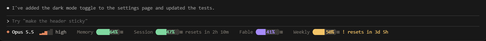
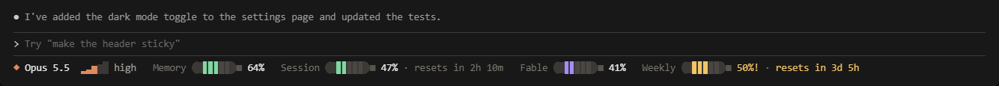
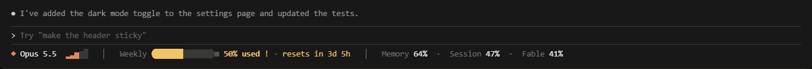
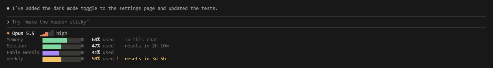
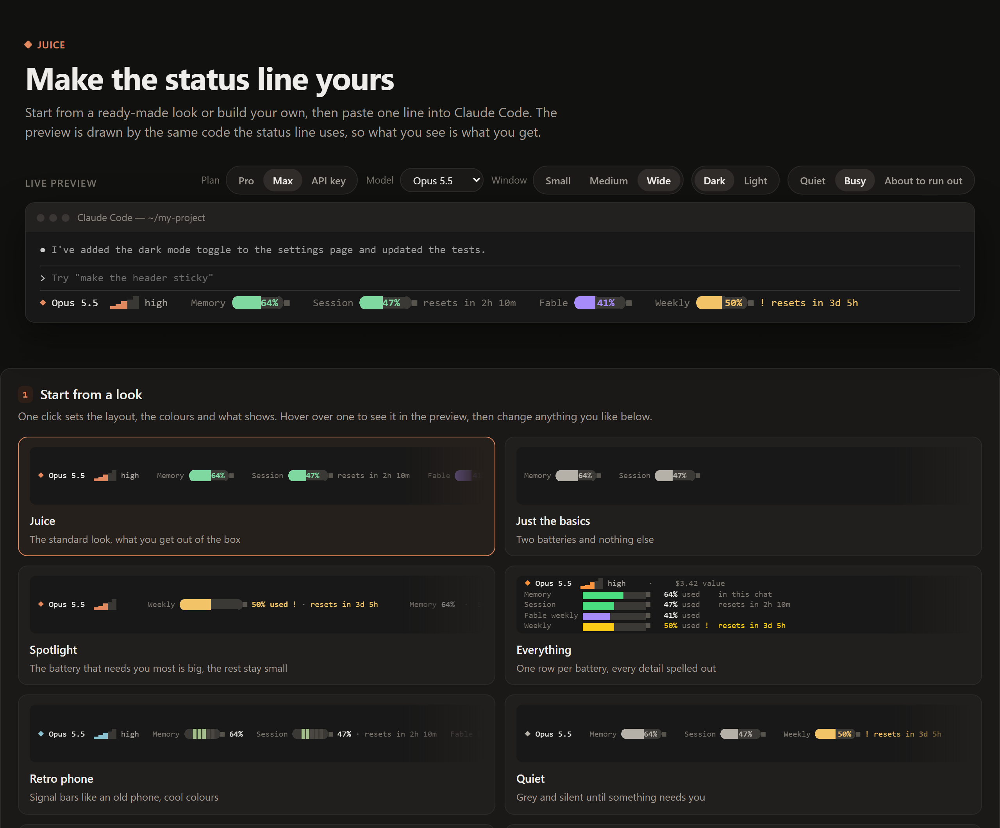

# juice

Juice replaces the row under your Claude Code prompt with little batteries. Each one shows how much of something you have **used**, counted the same way as Anthropic's usage page, and when it resets.


## What the batteries mean


| Battery | What it shows |
|---|---|
| **Memory** | How much of this chat's room is used. When it fills up, Claude summarises the chat to make space. |
| **Session** | Your 5-hour limit. |
| **Fable weekly** | The separate weekly limit for the Fable model. One-line layouts call it "Fable"; the panel says "Fable weekly". It resets together with Weekly, so it shows no countdown of its own while Weekly is shown. |
| **Weekly** | Your weekly limit. |

Next to the batteries you also see the model's name and its effort level: a little staircase that climbs from 1 step (low) to 5 steps (max), with the word beside it.

The colours for Session, Weekly and Fable weekly follow how fast you are going, not only how much is used:

- **Green** means plenty left.
- **Amber** with **!** means you are going a bit fast. At this pace you could run out before it resets.
- **Red** with **!!** means almost empty, or on track to run out before it resets.

The Fable bar is violet while it is fine, so the frontier model stands apart. When it goes fast or runs low, it turns amber or red with ! or !! like the others.


Next to each battery, juice counts down to its reset, for example "resets in 1h 31m" or "resets in 2d 5h".

Memory is simpler: it just turns amber, then red, as the chat fills up.

Pro and Max plans show the limits that apply to them. If you pay as you go with an API key, you see your cost instead.

## What you get


## Four layouts

Pick the one you like. The status bar is the default.

**Status bar** keeps everything on one line.



**Classic segments** draws each battery as five bars, like an old phone.



**Tightest first** gives the battery closest to empty a big spotlight and shrinks the rest to numbers.



**Panel** gives each battery its own row, with the most detail.



## Ready-made looks

A look picks the layout, the colours and what shows, all in one go. Your badges and Fable setting stay as they are. Pick one, then change anything you like.


| Look | What it is |
|---|---|
| **Juice** | The standard look. Also takes you back to it. |
| **Just the basics** | Two batteries and nothing else. |
| **Spotlight** | The battery that needs you most is big, the rest stay small. |
| **Everything** | One row per battery, every detail spelled out. |
| **Retro phone** | Signal bars like an old phone, in cool colours. |
| **Quiet** | Grey and silent until something needs you. |
| **Night owl** | Neon bars for dark terminals. |
| **Easy to see** | Big, bright and high contrast. |
| **Colour-blind friendly** | Blue, yellow and orange instead of green and red. |
| **Works everywhere** | For older terminals that show boxes instead of rounded ends. |
| **Cost watcher** | Shows what this chat would have cost. |
| **Fable first** | The Fable battery leads, and lights up while you use Fable. |

There are 13 colour sets to choose from: Claude, Frost, Calm, Colour-blind safe, High contrast, Ocean, Midnight, Vampire, Candy, Forest, Sunset, Solar and Rose. Or make your own in the customizer.


## Install

You need Node 18 or newer. To check, type `node --version` in a terminal. Then type these three lines into Claude Code, one at a time:

```
/plugin marketplace add zdraveski/claude-juice
/plugin install juice@juice
/juice setup
```

Juice saves your old status line first, if you had one, so you can always get it back.

## Make it yours

Type `/juice` and then say what you want, in your own words. For example:

- `/juice looks` (shows all 12 looks, numbered, and you answer with a number)
- `/juice use the quiet look`
- `/juice hide the cost`
- `/juice use the calm colours`
- `/juice show the reset times only when something needs attention`
- `/juice make it a panel`

Prefer to click? Open the customizer web page at https://zdraveski.github.io/claude-juice/web/. You can try every look, layout and colour with a live preview. It gives you one line to paste into Claude Code.



## Undo

`/juice restore` puts your old status line back.

Before you uninstall juice, run `/juice restore`.

## Badges

Badges are small optional extras that show the output of a command you choose. Juice only runs commands you added yourself with `/juice badges add`, after it shows you the command. On Windows, badge commands run in the Windows command prompt (cmd), not Git Bash, so write them for cmd.

## Privacy

- The Fable battery needs your Claude login token. That is the login key Claude Code keeps on your computer. Juice reads it from `~/.claude/.credentials.json`.
- The Fable battery is on by default on Windows and Linux. On a Mac it stays off until you type `/juice set fable=on`, and macOS will then ask once for permission to read it from the Keychain (the Mac's password store).
- Juice sends that token only to `api.anthropic.com`, to read your usage, about every 5 minutes. It never stores or logs it.
- The same answer also keeps Session and Weekly up to date in every window, including idle ones and brand-new chats. With the Fable battery off, those two come only from Claude Code itself, so an idle window can show older numbers.
- To switch the Fable battery off, run `/juice set fable=off`.
- Badges only run commands you added yourself with `/juice badges add`, after juice shows you the command.
