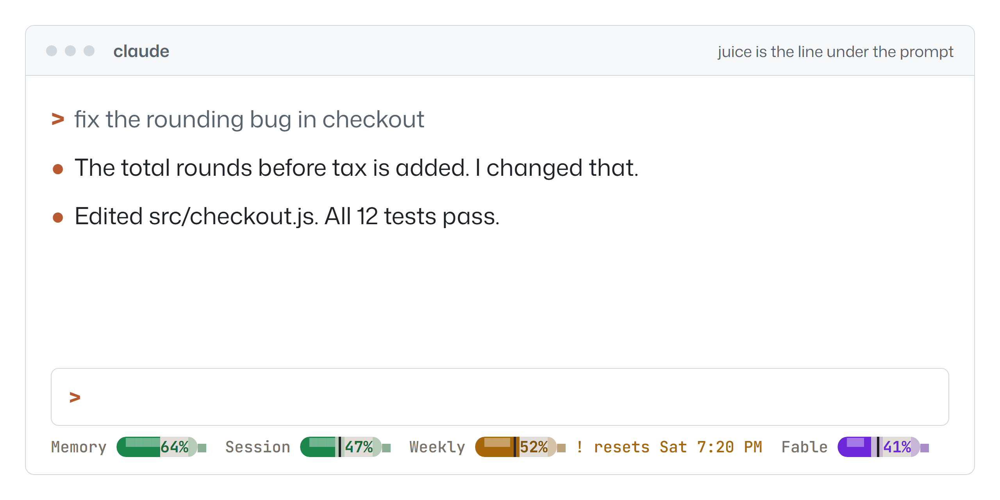
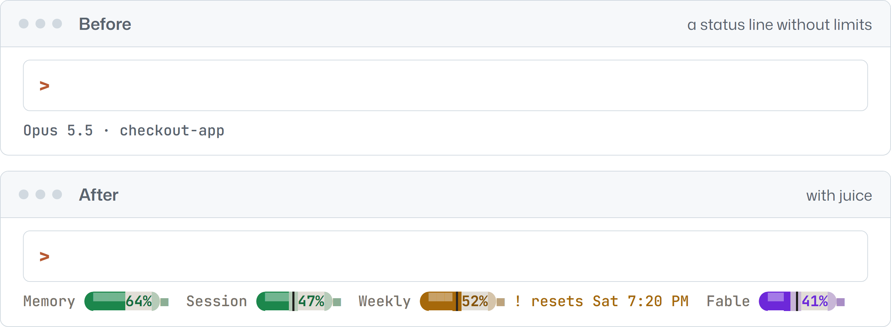
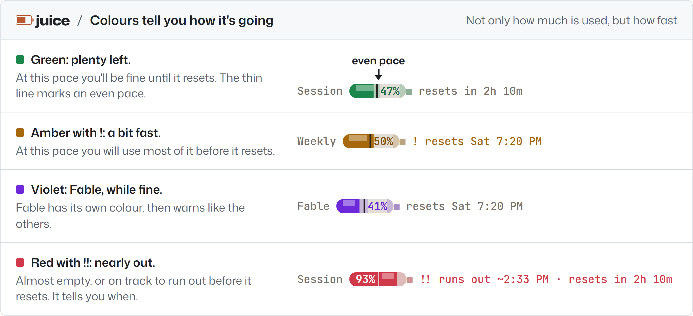
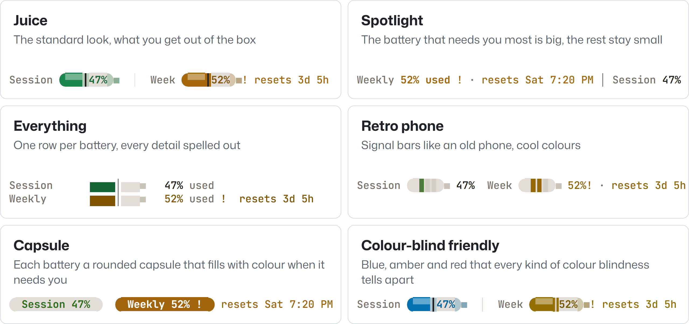

<div align="center">

# juice: usage limits for Claude Code

**See your Claude Code limits as batteries, and get warned before they run out.**

Free and unofficial. Not made by Anthropic.

[](https://github.com/zdraveski/claude-juice/actions/workflows/test.yml) [](https://github.com/zdraveski/claude-juice/releases/latest) [](LICENSE)   

[Install](#install) · [Guide](docs/guide.md) · [Commands](docs/commands.md) · [FAQ](docs/faq.md)

</div>

<picture>
  <source media="(prefers-color-scheme: dark)" srcset="docs/images/hero-dark.png">
  
</picture>

juice is a status line for Claude Code. It shows your limits as batteries under the prompt. It turns a battery amber, then red, when you are using it faster than the reset allows, and it shows when it resets.

- **Session** is your 5-hour limit and **Weekly** is your weekly limit.
- **Memory** is how full this chat is.
- **Fable** is the separate weekly limit for the Fable model.

<picture>
  <source media="(prefers-color-scheme: dark)" srcset="docs/images/before-after-dark.png">
  
</picture>

## Is it for you?

- You use Claude Code on a Pro or Max plan. With an API key, juice shows cost instead of limits.
- You run `claude` in a terminal on Windows, macOS or Linux. It does not show in the VS Code chat panel or the desktop app.
- You have Node 24 or newer. This is separate from Claude Code. `node --version` shows yours.

## Install

Type these into Claude Code, one at a time:

```
/plugin marketplace add zdraveski/claude-juice
/plugin install juice@juice
/reload-plugins
/juice setup
```

Setup saves a copy of your current status line, then switches to juice. `/juice restore` puts it back. The batteries fill in after Claude's first reply. Tested by hand when juice 1.0.0 shipped, with Claude Code 2.1.316 on Windows; CI tests every release on Windows, macOS and Linux. Older versions are untested.

To undo it, `/juice restore` puts your old status line back. Then remove juice in `/plugin`.

[Try it in your browser first, nothing to install.](https://zdraveski.github.io/claude-juice/web/)

[](https://zdraveski.github.io/claude-juice/web/)

The pictures here show VS Code's round battery ends. Other terminals show plain ends. `/juice use round ends` switches the round ones on.

## What the colours mean

<picture>
  <source media="(prefers-color-scheme: dark)" srcset="docs/images/colours-dark.png">
  
</picture>

- Green: plenty left. A thin line on the battery marks an even pace.
- Amber with `!`: you are going a bit fast. At this pace you will use most of it before it resets.
- Red with `!!`: nearly empty, or half used and heading for empty before the reset.

An amber or red battery also says when it runs out, for example "runs out ~4:04 PM, resets in 2h 10m". Session is your 5-hour limit and Weekly is your weekly limit. Memory is how full this chat is. Fable is the separate weekly limit for the Fable model. The [guide](docs/guide.md#what-the-batteries-mean) has the exact rules.

Session, Weekly and Memory come from Claude Code. Fable comes from one extra request to Anthropic, so it may stop working if that changes. The other three keep working. Session, Weekly and Memory were checked once against Anthropic's usage page, on a Max account. Pro is not checked. [FAQ](docs/faq.md#why-does-it-differ-from-usage) says what to compare.

## Make it yours

Pick one of 15 ready-made looks, then change the layout, colours or battery style. Each card shows its look in its own style, so the reset wording differs.

<picture>
  <source media="(prefers-color-scheme: dark)" srcset="docs/images/looks-grid-dark.png">
  
</picture>

Type `/juice` and say what you want in your own words:

```
/juice looks                       # list all 15 looks, numbered
/juice look 7                      # switch to number 7
/juice use the quiet look
/juice my terminal is light        # if the text is hard to read
```

All commands are in [docs/commands.md](docs/commands.md). Every look, layout and colour set is in the [guide](docs/guide.md).

## Safe to try

- Setup saves your old status line first. `/juice restore` puts it back. It also writes files only in your Claude folder.
- The only thing juice sends anywhere is one usage request to `api.anthropic.com`, and only while the Fable battery is on. juice asks before it reads your Claude login for that, unless you already had the Fable battery before 1.4.0 on Windows or Linux. No telemetry, no analytics.
- It has no dependencies, and adds about 60 ms to Node starting on an old laptop (`node scripts/bench.js` measures yours). It refreshes once a minute.
- Open source under MIT. Over 500 automated tests run in CI on Windows, macOS and Linux.

juice is new and small. Bug reports are read. [Privacy](docs/privacy.md) has the details, with links to the code that reads your login.

<details>
<summary>Update, fix or remove juice</summary>

- Update: open `/plugin`, pick juice, update it, then restart Claude Code. [What's new](CHANGELOG.md) lists each version.
- Fix: type `/juice doctor`. [Troubleshooting](docs/troubleshooting.md) covers common problems and uninstalling.
- If Claude Code does not know `/juice` after install, restart it and type `/juice setup` again.

</details>

## Help

[Bug report](https://github.com/zdraveski/claude-juice/issues/new?template=bug_report.yml) (include what `/juice doctor` says) · [Discussions](https://github.com/zdraveski/claude-juice/discussions) · [Security](SECURITY.md) · [Contributing](CONTRIBUTING.md) · [Privacy](docs/privacy.md) · [Troubleshooting](docs/troubleshooting.md)

juice is free and unofficial. It is not made by Anthropic.
