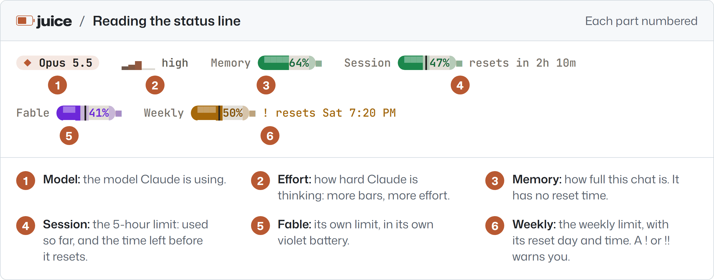
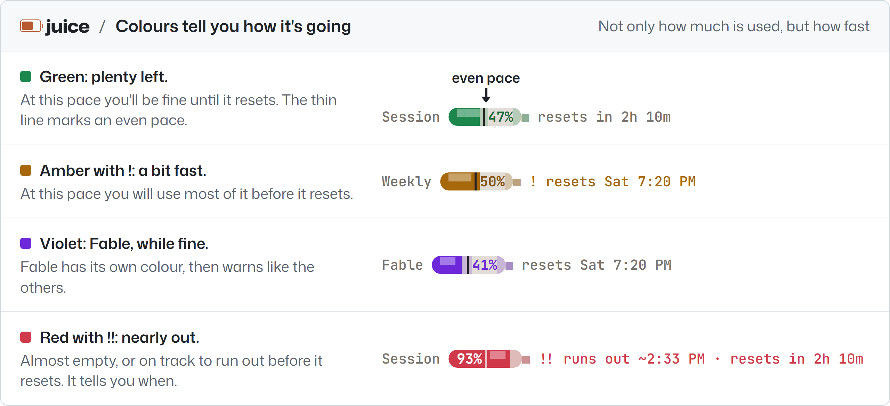
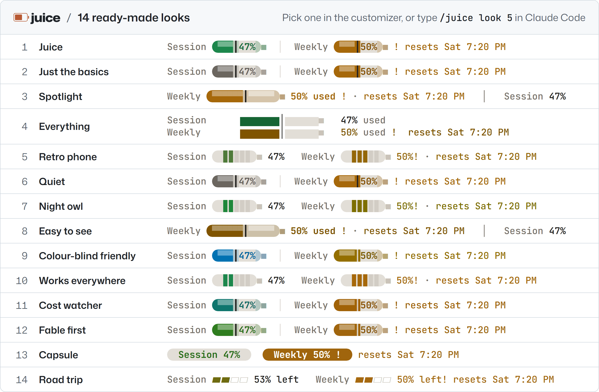
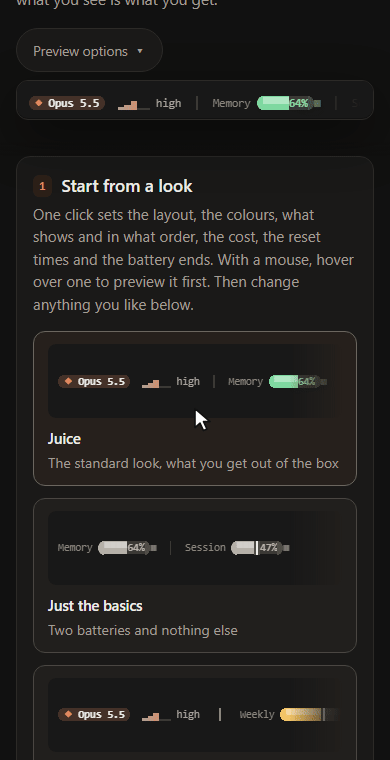

# The juice guide

[juice](../README.md) · [Guide](guide.md) · [Commands](commands.md) · [FAQ](faq.md) · [Badges](badges.md) · [Troubleshooting](troubleshooting.md) · [Privacy](privacy.md)

How to read juice, and every way to change how it looks. New here? [Install juice first](../README.md#install).

## Start here

- Each battery is one limit. The fuller it is, the more you have used.
- Green is fine, amber with ! is going fast, red with !! is nearly out.
- To change anything, type `/juice` and say what you want. [Commands](commands.md) lists them all.

[The batteries](#what-the-batteries-mean) · [Looks](#ready-made-looks) · [Layouts](#six-layouts) · [Colours](#colour-sets) · [Battery style](#battery-style) · [Change how it looks](#change-how-it-looks) · [How the numbers are worked out](#how-the-numbers-and-colours-are-worked-out) · [Motion and refresh](#motion-and-refresh) · [By system](#by-system)

## What the batteries mean

<picture>
  <source media="(prefers-color-scheme: dark)" srcset="images/anatomy-dark.png">
  
</picture>

| Part | What it shows |
|:---|:---|
| Model and effort | The model Claude is using, and its effort as a staircase of 1 step (low) to 5 steps (max) with the word beside it. |
| Memory | How full this chat is. When it fills up, Claude summarises the chat to make room. It has no reset time. |
| Session | Your 5-hour limit. |
| Fable | The separate weekly limit for the Fable model. It is called "Fable weekly" in the Panel layout and is the big battery in Tightest first. It resets with Weekly, so it shows no reset time of its own while Weekly is shown. |
| Weekly | Your weekly limit. |
| Budget | Only with a company spending limit: how much of it is used. Amber with ! at 85%, red with !! at 90%. |

Session and Weekly also say when they reset: "resets in 1h 31m" when it is less than a day away, otherwise the day and time ("resets Sat 7:20 PM"). Times use your computer's time zone. On a computer set to UTC, such as a remote one, they say "UTC".

Pro and Max plans show the limits that apply to them. If you pay as you go with an API key (billed for what you use, instead of a plan), you see your cost instead.

### How the colours work

The colours for Session, Weekly and Fable depend on your pace as well as on how much is used.

- Green means plenty left.
- Amber with ! means you are going a bit fast. At this pace you will use most of it (85% or more) before it resets.
- Red with !! means almost empty, or half or more used and on track to run out before it resets.
- An amber or red battery that is on track to run out also says when, for example "runs out ~4:04 PM · resets in 2h 10m".

While Fable is fine it has its own colour (violet in most colour sets), so you can tell it apart. When it goes fast or runs low it turns amber or red like the others. Memory has no pace. It turns amber, then red, as the chat fills up.

<picture>
  <source media="(prefers-color-scheme: dark)" srcset="images/colours-dark.png">
  
</picture>

A limit that is used up always shows, even in a look that leaves it out (Fable while you are using Fable). You never see "all fine" while you are locked out.

### The pace line

A thin line on a battery marks where you would be if you used the limit evenly. If the colour reaches past the line, you are going faster than that. Before the line, you have time to spare.

The Status bar, Tightest first and Panel layouts draw it. Of the battery shapes, only Pace race and Ruler do. The Pace style shows the same thing as a softer fill up to that point.

## Ready-made looks

A look sets the layout, colours, what shows and in what order, the cost, the reset times and the battery ends, all in one go. Pick one, then change anything you like.

- A look changes: layout, colours, what shows, order, cost, reset times, battery ends.
- A look keeps: your battery style (except Sand, see below), terminal colour, full-colour setting, motion, Fable setting and [badges](badges.md).

Sand also sets the sand battery. Picking any other look after that puts sand back to glossy, even if you chose sand yourself. Other battery styles stay.

If you chose round or plain ends yourself, type `/juice use round ends` or `/juice use plain ends` again after picking a look.

<picture>
  <source media="(prefers-color-scheme: dark)" srcset="images/looks-dark.png">
  
</picture>

Type `/juice look 7` to switch to number 7. `/juice looks` prints all 15.

<details>
<summary>The 15 looks in words</summary>

| # | Look | What it is |
|:---|:---|:---|
| 1 | Juice | The standard look. Pick it to go back to the start. |
| 2 | Just the basics | Two batteries and nothing else. |
| 3 | Spotlight | The battery that needs you most is big, the rest stay small. |
| 4 | Everything | One row per battery, every detail spelled out. |
| 5 | Retro phone | Signal bars like an old phone, in cool colours. |
| 6 | Quiet | Grey until something needs you. Reset times only show then. |
| 7 | Night owl | Neon bars for dark terminals. |
| 8 | Easy to see | Like Spotlight, in bright high-contrast colours. |
| 9 | Colour-blind friendly | Blue, amber and red that every kind of colour blindness tells apart. |
| 10 | Works everywhere | For older terminals that show boxes instead of rounded ends. |
| 11 | Cost watcher | Shows what this chat would have cost. |
| 12 | Fable first | The Fable battery leads, and lights up while you use Fable. |
| 13 | Capsule | Rounded capsules in Candy colours that fill with colour when they need you. |
| 14 | Road trip | A fuel gauge in Forest colours: shows what is left, not what is used. |
| 15 | Sand | Batteries that fill like an hourglass, in bold colours. |

</details>

## Six layouts

A look and a layout are different things. A look picks a layout and more. Spotlight, for example, is a look that uses the Tightest first layout.

| Layout | What it does | See it in the look |
|:---|:---|:---|
| Status bar (the default) | Everything on one line. | Juice |
| Classic segments | Each battery is five bars, like the signal on an old phone. | Retro phone |
| Tightest first | The battery closest to running out gets big; the rest shrink to numbers. | Spotlight |
| Panel | Each battery gets its own row, with the most detail. | Everything |
| Capsules | Each battery is a rounded capsule. A fine one stays dark; one that needs you fills with its colour, and only that one says its times. | Capsule |
| Fuel tank | Shows what is left instead of what is used, like a fuel gauge: the bar empties as you work. | Road trip |

The batteries keep the order you chose. To let them move instead, type `/juice put the one that needs me first` (red, then amber, then fine) or `/juice put the fullest first`. `/juice keep my order` puts them back.

## Colour sets

There are 14 colour sets. 13 have fixed colours: Claude, Frost, Calm, Colour-blind safe, High contrast, Ocean, Midnight, Vampire, Candy, Forest, Sunset, Solar and Rose. The 14th, Terminal (`/juice set colors=terminal`), uses your terminal's own 16 colours, so it follows any colour scheme you set there. juice cannot promise those read well. That depends on your scheme.

Every colour in the 13 fixed sets reads at a contrast of 4.5:1 or more on its terminal, the usual bar for small text (WCAG AA). You can make your own in the customizer, which tells you when one is hard to read.

<picture>
  <source media="(prefers-color-scheme: dark)" srcset="images/colour-sets-dark.png">
  
</picture>

## Battery style

The batteries in the Status bar and Tightest first layouts can be drawn six ways, or swapped for one of eight shapes. The other layouts keep their own shapes.

| Style | What it looks like |
|:---|:---|
| Glossy (the default) | Each battery lit from above, in glass tinted by its colour. |
| Classic | The flat bars juice started with. Type `/juice set battery=classic` to go back to them. |
| Outline | Thin walls and dots, no filled casing. |
| Hot tip | When a battery turns amber or red, its fill heats from the plenty-left colour (green in most sets) to that colour. |
| Liquid edge | A bright edge where the fill ends. |
| Pace glow | The fill is soft up to where even use would be now, and bright past it, so going fast shows at a glance. |

The shapes put the number after them, and read without colour too.

| Shape | Example at 47% | What it is |
|:---|:---|:---|
| Pie | `◑ 47%` | One little pie that fills by quarters. |
| Sand | `⣿⣿⣄⠂⠂ 47%` | Fine grains that pile up, eight to a cell. |
| Slider | `━━━●──── 47%` | A knob on a track. |
| Pace race | `···│●···· 47%` | You (●) racing even use (│). Here you are ahead of the line, so going fast. On the line, you cover it. |
| Lives | `♥♥♥♡♡ 47%` | What is left, as hearts. |
| Dots | `••••···· 47%` | A string of beads. |
| Chevrons | `▸▸▸▹▹▹ 47%` | Arrows that march on as you use it. |
| Ruler | `┣━━╋━────┫ 47%` | A ruler with even use as a tick. Here the tick is inside the fill, so you are ahead. On pace it sits on the fill's end. Behind, it stands past it as `┿`. |

The Pace race and Ruler examples are 47% used with 40% of the window gone. Pie, Sand, Chevrons, Lives and Ruler need a font that has those signs (Cascadia Code, JetBrains Mono and Menlo do). If you see boxes, pick another.

Pick one in the customizer, or type `/juice set battery=outline` (or glossy, classic, outline, hot, liquid, pace, pie, sand, slider, race, lives, dots, chevrons, ruler).

## Change how it looks

[Open the live customizer](https://zdraveski.github.io/claude-juice/web/) to try every look, layout and colour with a live preview, then copy one line into Claude Code. It runs in your browser, so there is nothing to install.

[](https://zdraveski.github.io/claude-juice/web/)

Or type `/juice` and say what you want in your own words. Claude reads what follows, turns it into the matching command, runs it and tells you what changed. A few examples:

```
/juice looks                  # show all 15 looks, numbered
/juice use the quiet look
/juice hide the cost
/juice use the calm colours
/juice make it a panel
/juice my terminal is light   # if the text is hard to read on a light background
/juice customize              # open the customizer with your current settings
```

The full list, with every setting and its values, is in [Commands](commands.md). `/juice restore` puts your old status line back.

## How the numbers and colours are worked out

Session, Weekly and Fable are colour-coded by how much is used and by how fast you are using it.

1. juice takes how much of the window is used, and how much of the window has passed.
2. It divides the first by the second to guess where you will be when the window ends.
3. At 90% used, or at 50% used and heading past 100%, the battery is red.
4. If the guess reaches 85% or more, it is amber.
5. Otherwise it is green.

Example: your 5-hour Session is 2 hours in (40% of the window) and 47% is used. 47 divided by 0.4 is about 118%. That is over 85%, so the battery is amber with !. It is under 50% used, so it is not red yet. Because the guess is past 100%, it also says when you would run out.

Early on, pace is noisy. juice ignores it in the first tenth of a window (at most the first 3 hours), unless half is already used. Memory is simpler: amber at 70%, red at 85%.

## Motion and refresh

By default the effort staircase and the batteries stand still at their true level. juice refreshes once a minute, so numbers and reset times stay current while Claude Code is idle, at almost no cost.

To make them move, type `/juice set motion=on`.

- The staircase climbs to your level, one step every 2 seconds, holds there, then starts again. The word always says the level. When a narrow window hides the word, the staircase stands still.
- The batteries' pictures climb the same way, in four steps from a quarter of the way up to the real amount. Everything starts again together every 12 seconds. The number and words beside them never move, and a red battery stands still.
- With motion on, juice refreshes every second (twice a step, so no step is skipped). That costs about a sixth of one processor core for each open Claude Code window.

If you set your own refresh time in Claude Code's settings (`refreshInterval`, in seconds), such as 10 or 20, juice keeps it either way. It changes only 1, 30 and 60, the times juice writes itself.

The rounded battery ends in the pictures show on their own in VS Code. Other terminals get plain ends, because some fonts draw the rounded ones as boxes. If yours can draw them, type `/juice use round ends`.

### What a narrow window drops

In a narrow window juice makes room one step at a time. Whatever it frees gets used again, so a battery keeps its picture whenever it fits.

<details>
<summary>The six steps, in order</summary>

1. Badges, reset times, the effort word and the cost go first.
2. Then the effort level and the model name.
3. Then spacing, battery size, an amber battery's run-out time, the reset time beside a run-out time, and shorter warning words.
4. Then every battery shows as words only (`Session 88%!! out ~2:44 PM`).
5. Then the batteries that are fine go, then the amber ones.
6. Last goes a red battery's words ("out ~2:44 PM"), so a red battery itself is the last thing to go.

Only in a very small window is the end of the line cut.

</details>

## By system

juice runs on Windows, macOS and Linux, in the terminal where you type `claude`.

- Your Claude folder is `~/.claude` (on Windows, `.claude` in your user folder), or the folder in `CLAUDE_CONFIG_DIR` if you set it. juice keeps its files there.
- On Windows, badge commands run in the command prompt (cmd), not Git Bash. See [Badges](badges.md#on-windows).
- On a Mac, the Fable battery makes macOS ask once for permission to read the sign-in from the Keychain. It is safe to allow or deny.
- On Windows and Linux, the Fable battery reads `.credentials.json` in your Claude folder.
- The macOS Terminal app before macOS 26 does not draw full colour. iTerm2, Windows Terminal, VS Code and kitty do. See [Troubleshooting](troubleshooting.md) if colours look off.
