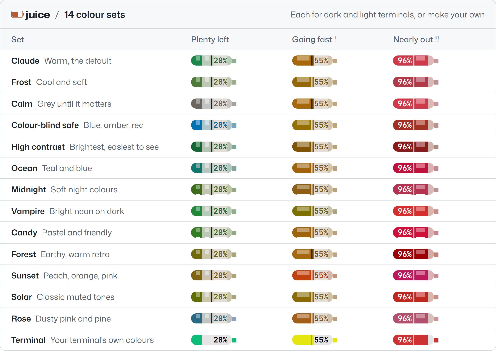

# The juice guide

[← Back to juice](../README.md)

Everything juice can show, and every way to change how it looks. New here? [Install juice first](../README.md#install).

[The batteries](#what-the-batteries-mean) · [Looks](#ready-made-looks) · [Layouts](#six-layouts) · [Colours](#colour-sets) · [Change how it looks](#change-how-it-looks) · [Battery style](#battery-style)

## What the batteries mean

<picture>
  <source media="(prefers-color-scheme: dark)" srcset="images/anatomy-dark.png">
  
</picture>

| Battery | What it shows |
|:---|:---|
| Memory | How full this chat is. When it fills up, Claude summarises the chat to make room. |
| Session | Your 5-hour limit. |
| Fable | The separate weekly limit for the Fable model, called "Fable weekly" in the Panel layout and as the big battery in Tightest first. It resets with Weekly, so it shows no reset time of its own while Weekly is shown. |
| Weekly | Your weekly limit. |
| Budget | Only with a company spending limit: how much of it is used. Amber with ! at 85%, red with !! at 90%. |

Next to the batteries you also see the model's name and its effort level: a little staircase from 1 step (low) to 5 steps (max), with the word beside it. By default the staircase and the batteries stand still at their true level, and juice refreshes once a minute, so the numbers and reset times stay current while Claude Code is idle at almost no cost.

To make them move, type `/juice set motion=on`. The staircase then climbs up to your level, one step every 2 seconds, holds there, then starts again; the word always says the level (when a narrow window hides the word, the staircase stands still). The batteries' pictures climb the same way, in four steps from a quarter of the way up to the real amount, and everything starts again together every 12 seconds; the number and words beside them never move, and a red battery stands still. With motion on, juice refreshes every second (twice a step, so no step is skipped). That costs about a sixth of one processor core for each open Claude Code window.

If you set your own refresh time in Claude Code's settings (`refreshInterval`, in seconds), such as 10 or 20, juice keeps it either way. It changes only 1, 30 and 60, the times juice writes itself.

The rounded battery ends in the pictures show on their own in VS Code. Other terminals get plain ends, because some fonts draw the rounded ones as boxes; if yours can draw them, type `/juice use round ends`.

Session and Weekly also say when they reset: "resets in 1h 31m" when it is less than a day away, otherwise the day and time ("resets Sat 7:20 PM"). Times are in your computer's time zone; on a computer set to UTC, such as a remote computer you work on from yours, they say "UTC".

The colours for Session, Weekly and Fable depend on your pace as well as on how much is used:

- Green means plenty left.
- Amber with ! means you are going a bit fast. At this pace you will use most of it (85% or more) before it resets.
- Red with !! means almost empty, or half or more used and on track to run out before it resets.
- An amber or red battery that is on track to run out before it resets also says when, for example "runs out ~4:04 PM · resets in 2h 10m".

While Fable is fine it has its own colour (violet in most colour sets), so you can tell it apart. When it goes fast or runs low it turns amber or red with ! or !! like the others.

<picture>
  <source media="(prefers-color-scheme: dark)" srcset="images/colours-dark.png">
  
</picture>

In the Status bar, Tightest first and Panel layouts, a thin line on these batteries marks where you would be if you used the limit evenly. If the colour reaches past the line, you are going faster than that. Before the line, you have time to spare. The Pace style shows the same thing as a softer fill up to that point. Of the shapes, only Pace race and Ruler draw the line.

A limit that is used up always shows, even in a look that leaves it out (Fable while you are using Fable), so you never see "all fine" while you are locked out.

Memory has no pace or reset. It turns amber, then red, as the chat fills up.

Pro and Max plans show the limits that apply to them. If you pay as you go with an API key (billed for what you use, instead of a plan), you see your cost instead.

## Ready-made looks

A look sets the layout, the colours, what shows and in what order, the cost, the reset times and the battery ends, all in one go. Your battery style, terminal colour, motion, Fable setting and badges stay as they are. Pick one, then change anything you like. (If you chose round or plain ends yourself, type `/juice use round ends` or `/juice use plain ends` again after picking a look.)

<picture>
  <source media="(prefers-color-scheme: dark)" srcset="images/looks-dark.png">
  
</picture>

The 14 looks in words

| Look | What it is |
|:---|:---|
| Juice | The standard look. Pick it to go back to the start. |
| Just the basics | Two batteries and nothing else. |
| Spotlight | The battery that needs you most is big, the rest stay small. |
| Everything | One row per battery, every detail spelled out. |
| Retro phone | Signal bars like an old phone, in cool colours. |
| Quiet | Grey until something needs you. Reset times only show then. |
| Night owl | Neon bars for dark terminals. |
| Easy to see | Like Spotlight, in bright high-contrast colours. |
| Colour-blind friendly | Blue, amber and red that every kind of colour blindness tells apart. |
| Works everywhere | For older terminals that show boxes instead of rounded ends. |
| Cost watcher | Shows what this chat would have cost. |
| Fable first | The Fable battery leads, and lights up while you use Fable. |
| Capsule | Rounded capsules in Candy colours that fill with colour when they need you. |
| Road trip | A fuel gauge in Forest colours: shows what is left, not what is used. |

Capsule and Road trip use the Capsules and Fuel tank layouts (see [Six layouts](#six-layouts)).

### Six layouts

| Layout | What it does | See it in the look |
|:---|:---|:---|
| Status bar (the default) | Everything on one line. | Juice |
| Classic segments | Each battery is five bars, like the signal on an old phone. | Retro phone |
| Tightest first | The battery closest to running out gets big; the rest shrink to numbers. | Spotlight |
| Panel | Each battery gets its own row, with the most detail. | Everything |
| Capsules | Each battery is a rounded capsule. A fine one stays dark; one that needs you fills with its colour, and only that one says its times. | Capsule |
| Fuel tank | Shows what is left instead of what is used, like a fuel gauge: the bar empties as you work. | Road trip |

The batteries keep the order you chose. To let them move instead, type `/juice put the one that needs me first` (red, then amber, then fine) or `/juice put the fullest first`. `/juice keep my order` puts them back.

### Colour sets

There are 13 colour sets to choose from: Claude, Frost, Calm, Colour-blind safe, High contrast, Ocean, Midnight, Vampire, Candy, Forest, Sunset, Solar and Rose. Every colour in them reads at 4.5:1 or more on its terminal. Or make your own in the customizer, which tells you when one is hard to read.

<picture>
  <source media="(prefers-color-scheme: dark)" srcset="images/colour-sets-dark.png">
  
</picture>

## Change how it looks

[Open the live customizer](https://zdraveski.github.io/claude-juice/web/) to try every look, layout and colour with a live preview, then copy one line into Claude Code. It runs in your browser, so there is nothing to install.

Or type `/juice` and then say what you want, in your own words. For example:

- `/juice looks` (shows all 14 looks, numbered; then `/juice look 7` switches to number 7)
- `/juice use the quiet look`
- `/juice hide the cost`
- `/juice use the calm colours`
- `/juice show the reset times only when something needs attention`
- `/juice make it a panel`
- `/juice my terminal is light` (if the text is hard to read on a light background)
- `/juice set motion=on` (the effort level and batteries climb; juice then refreshes every second, about a sixth of a CPU core per open window)
- `/juice customize` (opens the live customizer with your current settings)

### Battery style

The batteries in the Status bar and Tightest first layouts can be drawn six ways, or swapped for one of eight shapes. The other layouts keep their own shapes.

- **Glossy** (the default): each battery lit from above, in glass tinted by its colour.
- **Classic**: the flat bars juice started with. Type `/juice set battery=classic` to go back to them.
- **Outline**: thin walls and dots, no filled casing.
- **Hot tip**: when a battery turns amber or red, its fill heats from the plenty-left colour (green in most sets) to that colour.
- **Liquid edge**: a bright edge where the fill ends.
- **Pace glow**: the fill is soft up to where even use would be now, and bright past it, so going fast shows at a glance.

The shapes put the number after them, and read without colour too:

- **Pie** `◑ 47%`: one little pie that fills by quarters.
- **Sand** `⣿⣿⣄⠂⠂ 47%`: fine grains that pile up, eight to a cell.
- **Slider** `━━━●──── 47%`: a knob on a track.
- **Pace race** `···│●···· 47%`: you (●) racing even use (│). Here you're ahead of the line, so going fast. On the line, you cover it.
- **Lives** `♥♥♥♡♡ 47%`: what is left, as hearts.
- **Dots** `••••···· 47%`: a string of beads.
- **Chevrons** `▸▸▸▹▹▹ 47%`: arrows that march on as you use it.
- **Ruler** `┣━━╋━────┫ 47%`: a ruler with even use as a tick. Here the tick is inside the fill, so you're ahead. On pace it sits on the fill's end; behind, it stands past it as `┿`.

The Pace race and Ruler examples are 47% used with 40% of the window gone. Of the shapes, only those two show where even use would be. Pie, Sand, Chevrons, Lives and Ruler need a font that has those signs (Cascadia Code, JetBrains Mono and Menlo do). If you see boxes, pick another.

Pick one in the customizer, or type `/juice set battery=outline` (or any of glossy, classic, outline, hot, liquid, pace, pie, sand, slider, race, lives, dots, chevrons, ruler).

In a narrow window juice drops the extras first and keeps the batteries that need you until last.

What a narrow window drops, in order

In a narrow window juice makes room step by step. First go badges, reset times, the effort word and cost, then the effort level and the model name. Next come spacing, battery size, an amber battery's run-out time, the reset time beside a run-out time, and shorter warning words. Then every battery shows as words only (`Session 88%!! out ~2:44 PM`). After that go the batteries that are fine, then the amber ones, and last a red battery's words ("out ~2:44 PM"), so a red battery itself is the last thing to go. Whatever freed room gets used again, so a battery keeps its picture whenever it fits. Only in a very small window is the end of the line cut.

